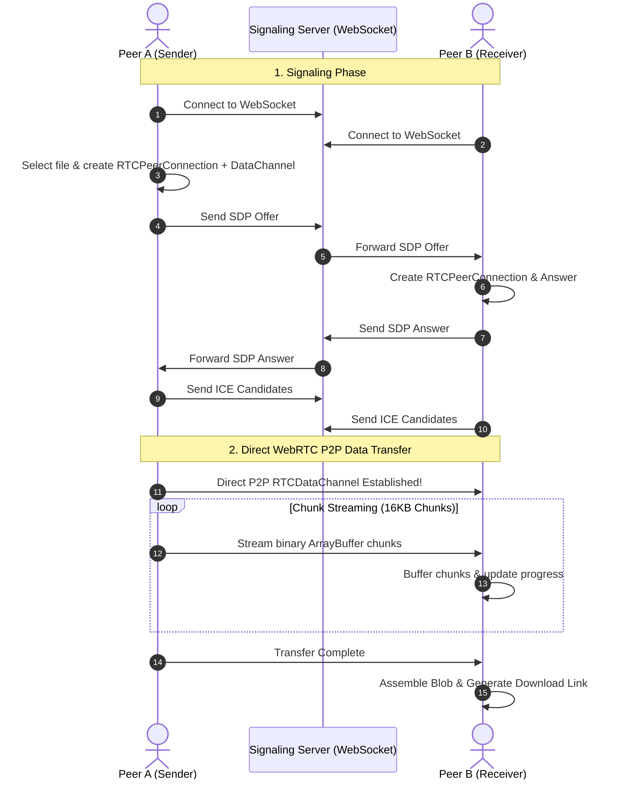

# 🚀 ShareP2P

> **Direct Browser-to-Browser Peer-to-Peer File Sharing**  
> Fast, private, and serverless file transfers powered by **WebRTC** and **WebSockets**.

---

## 🌟 Overview

**ShareP2P** is a lightweight, zero-dependency peer-to-peer file transfer application. By leveraging WebRTC's `RTCDataChannel`, files are streamed directly between browsers without ever passing through or being stored on an intermediate server. 

A minimal WebSocket server acts as the initial signaling channel to exchange connection metadata (SDP offers/answers and ICE candidates). Once the WebRTC handshake completes, all file data moves strictly device-to-device.

---

## ✨ Features

- **🔒 Direct Peer-to-Peer Transfer**: Files never touch a central storage server—transfer occurs straight between peers.
- **⚡ Chunked Binary Streaming**: Efficiently slices and streams files in 16KB `ArrayBuffer` chunks via WebRTC `RTCDataChannel`.
- **📊 Real-Time Progress Bar**: Visual feedback on transfer status and completion.
- **🌐 Zero Client Dependencies**: Built entirely with standard vanilla JavaScript, HTML5, and the WebRTC API—no bulky libraries or frameworks required.
- **🛡️ Secure Signaling**: Uses WebSockets for exchange of session descriptions (SDP) and ICE candidates.

---

## 🏗️ Architecture & How It Works



---

## 🚀 Getting Started

### 1. Clone the Repository

```bash
git clone https://github.com/harsheet20007/sharep2p.git
cd sharep2p
```

### 2. Run a Local Signaling Server

WebRTC requires a lightweight signaling server to relay the initial handshake between peers.

Create a minimal Node.js WebSocket server (`server.js`):

```javascript
// server.js
const WebSocket = require('ws');
const wss = new WebSocket.Server({ port: 8000 });

console.log('Signaling server listening on ws://localhost:8000');

wss.on('connection', (ws) => {
    ws.on('message', (message) => {
        // Broadcast signaling messages to all other connected peers
        wss.clients.forEach((client) => {
            if (client !== ws && client.readyState === WebSocket.OPEN) {
                client.send(message.toString());
            }
        });
    });
});
```

Run the server:
```bash
npm install ws
node server.js
```

### 3. Configure and Launch the Web Client

1. Open `index.html` and verify the WebSocket signaling address points to your server:
   ```javascript
   const ws = new WebSocket('ws://localhost:8000');
   ```

2. Serve `index.html` using any local HTTP server:
   ```bash
   npx serve .
   # or
   python3 -m http.server 3000
   ```

3. Open `http://localhost:3000` in two different browser windows or devices.
4. Select a file on Window A and click **Share File**.
5. Window B receives the file chunks and displays a download link upon completion.

---

## ⚙️ Key Technical Specifications

| Component | Specification |
| :--- | :--- |
| **Transport Protocol** | WebRTC `RTCDataChannel` (SCTP over DTLS/UDP) |
| **Signaling Protocol** | WebSocket (`ws://` / `wss://`) |
| **Data Format** | Binary `ArrayBuffer` |
| **Chunk Size** | 16,384 bytes (16 KB) |
| **Browser Compatibility** | Chrome, Firefox, Safari, Edge (Any WebRTC-compliant browser) |

---

## 💡 Future Enhancements

- [ ] Support for multiple concurrent files and folder transfers
- [ ] End-to-end encryption key verification
- [ ] Room/PIN-based peer matching
- [ ] Automatic fallback to TURN relay when direct P2P connection is blocked by strict NAT/firewalls
- [ ] Responsive modern UI with drag-and-drop file support

---

## 🤝 Contributing

Contributions, feedback, and pull requests are welcome!
1. Fork the Project
2. Create your Feature Branch (`git checkout -b feature/AmazingFeature`)
3. Commit your Changes (`git commit -m 'Add some AmazingFeature'`)
4. Push to the Branch (`git push origin feature/AmazingFeature`)
5. Open a Pull Request

---

## 📄 License

This project is open-source and available under the [MIT License](LICENSE).
